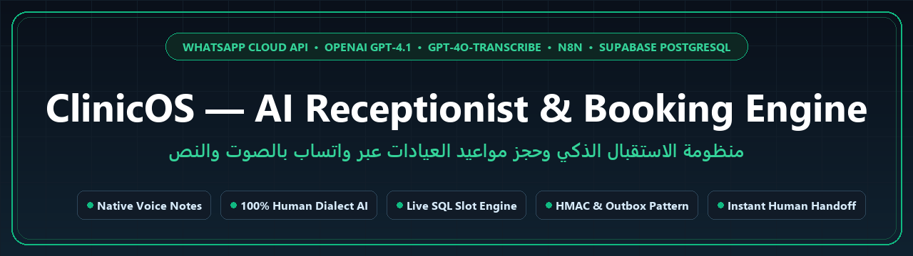
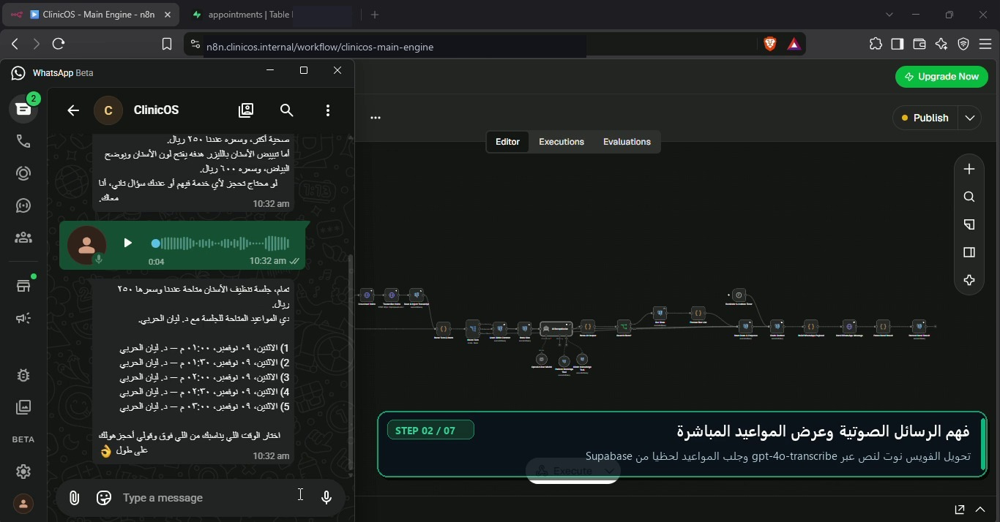
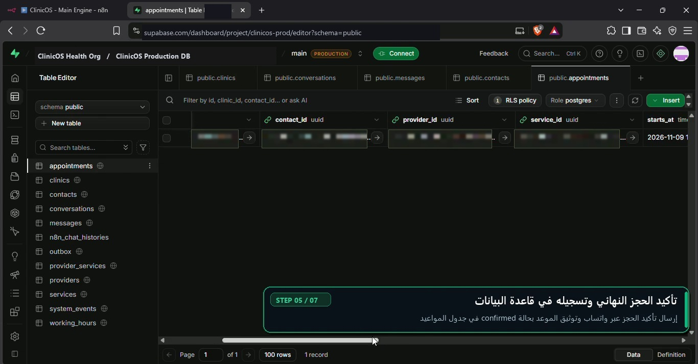
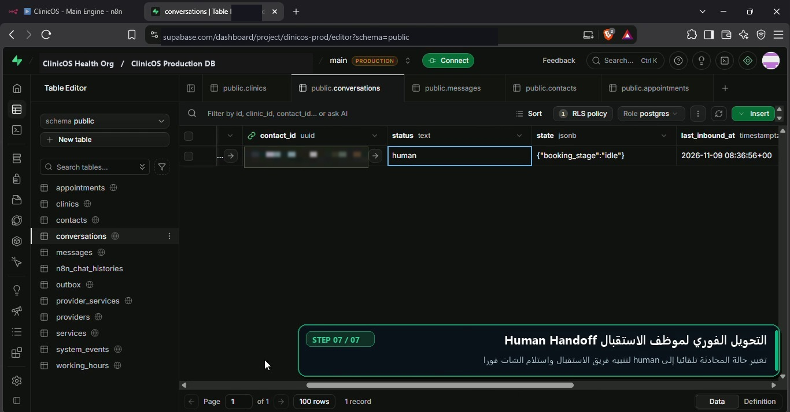

<div align="center">



<br />

# 🏥 ClinicOS `v3.3` — Production-Grade WhatsApp AI Receptionist & Appointment Engine
### منظومة الاستقبال الذكي وإدارة حجوزات العيادات عبر واتساب بالصوت والنص

[](https://youtu.be/YoO-eJfvpjM)
[](./workflow/clinicos-main-engine.json)
[](./prompts/receptionist-system-prompt.xml)
[](./prompts/voice-transcription-prompts.md)
[](./database/)
[](./workflow/clinicos-main-engine.json)
[-22c55e?style=for-the-badge&logo=checkmarx&logoColor=white)](./tests/test_270_messages.js)

<p align="center">
  
  
  
  
  
</p>

<p align="center">
  <a href="#-executive-overview--نبذة-عن-المشروع">🎯 Overview</a> •
  <a href="#-n8n-30-node-pipeline-architecture--معمارية-ورك-فلو-n8n">⚙️ 30-Node n8n Pipeline</a> •
  <a href="#-senior-engineering-decisions--قرارات-التصميم-الهندسية">🧱 Engineering Decisions</a> •
  <a href="#-270-scenario-adversarial--qa-benchmark--اختبارات-الجودة-والاختراق">🛡️ 270-Test Benchmark</a> •
  <a href="#-visual-walkthrough--استعراض-النظام">🎥 Walkthrough</a> •
  <a href="#-quick-start--خطوات-التشغيل">🚀 Quick Start</a>
</p>

</div>

---

## 🎯 Executive Overview | نبذة عن المشروع

**ClinicOS (`v3.3`)** is a production-hardened **WhatsApp AI Receptionist & Appointment Management Engine** engineered for specialty medical clinics (Dentistry, Dermatology & Laser).

Most AI booking bots fail in production because they allow an LLM to hallucinate available slots, lose context across turns, break on colloquial Arabic voice notes, or double-book providers when two patients message at the same time. **ClinicOS solves this through a strict architectural separation of concerns:**

> 🧠 **The AI Talks, The Database Decides.**
> OpenAI `gpt-4.1` and `gpt-4o-transcribe` handle natural human conversation, dialect adaptation (`ar-EG`, `ar-SA`, `en`), and compound-intent understanding — while a **4-layer deterministic JavaScript guardrail engine in `n8n`** and **32 atomic `Supabase PostgreSQL` RPCs** control slot availability, first-time patient registration, GiST exclusion locking, idempotent outbox dispatch, and medical safety escalation.

نظام **ClinicOS** هو محرك استقبال ذكي متكامل للعيادات الطبية عبر واتساب، مصمم بمعايير هندسية متقدمة ليجمع بين **المرونة البشرية الكاملة (100% Human-Like Persona)** في فهم الرسائل النصية والصوتية باللهجة المصرية والسعودية والإنجليزية، وبين **الحتمية الصارمة على مستوى قاعدة البيانات** لمنع أي هلوسة في المواعيد أو الأسعار أو تضارب الحجوزات.

---

## 🏗️ System Architecture | المعمارية الهندسية الشاملة

```mermaid
flowchart TB
    subgraph S1["1️⃣ Webhook Security & HMAC Ingestion"]
        WA["📱 Meta WhatsApp Cloud API v21.0"] -->|GET Challenge| GET_WH["GET Webhook"]
        GET_WH --> VERIFY_TOK["Verify Token (Vault RPC)"] --> CHAL_REPLY["Challenge Reply"]
        WA -->|POST Event + X-Hub-Signature-256| POST_WH["WhatsApp Webhook"]
        POST_WH --> RAW_BODY["Extract Raw Body (SHA-256 Prep)"]
        RAW_BODY --> INGEST["Verify & Save Event\npublic.ingest_meta_webhook_batch()"]
    end

    subgraph S2["2️⃣ State-Aware Voice Note Pipeline"]
        INGEST --> IS_VOICE{"Is Voice Note?"}
        IS_VOICE -->|audio / voice| GET_URL["Get Audio URL (Graph API)"]
        GET_URL --> DL_VOICE["Download OGG Stream"]
        DL_VOICE --> STT["Transcribe Voice (gpt-4o-transcribe)\n+ Dynamic Pending-Slot Vocabulary"]
        STT --> SAVE_STT["Save & Inject Transcript\npublic.apply_voice_transcription()"]
    end

    subgraph S3["3️⃣ Turn Router & Persistent Memory Loader"]
        IS_VOICE -->|text / media| PARSE_TURN["Parse Turn & State\nPrune Expired Holds + Media Fallbacks"]
        SAVE_STT --> PARSE_TURN
        PARSE_TURN --> ROUTE{"Route Turn"}
        ROUTE -->|AI Assistant| LOAD_CTX["Load Clinic Context\nSnapshot + 16-Turn History + Patient Profile"]
    end

    subgraph S4["4️⃣ Hybrid AI Agent & 4-Layer Deterministic Guardrails"]
        LOAD_CTX --> AI_AGENT["AI Receptionist (OpenAI GPT-4.1)\nStructured JSON Contract"]
        AI_AGENT --> PARSE_AI["Parse AI Output\n4-Layer Slot Resolver + Name/Phone Gate"]
        PARSE_AI --> EMERG_GUARD["Emergency & Medical Safety Guard\nHard Regex + LLM Escalation"]
    end

    subgraph S5["5️⃣ Atomic Slot Engine & Transactional Commit"]
        EMERG_GUARD --> SEARCH_IF{"Search Slots?"}
        SEARCH_IF -->|true| GET_SLOTS["Get Slots\nPrimary Window + 7-Day Fallback CTE"]
        GET_SLOTS --> FMT_SLOTS["Format Slot List\nAuto-Preselect Exact Match"]
        FMT_SLOTS --> SAVE_STATE["Save State & Enqueue\nbook / reschedule / cancel / profile / outbox"]
        SEARCH_IF -->|false| SAVE_STATE
        ROUTE -->|Direct Reply| SAVE_STATE
    end

    subgraph S6["6️⃣ Durable Outbox & 24h Reminder Dispatcher"]
        TIMER["⏰ Reminder & Outbox Timer (Every 15m)"] --> CLAIM["Claim Outbox\nFOR UPDATE SKIP LOCKED + Lease Token"]
        SAVE_STATE --> CLAIM
        CLAIM --> BUILD_WA["Build WhatsApp Payload"]
        BUILD_WA --> SEND_WA["Send WhatsApp Message"]
        SEND_WA --> PARSE_SEND["Parse Send Result\nClassify Retryable vs Permanent"]
        PARSE_SEND --> REC_SEND["Record Send Result\nExponential Backoff / Dead-Letter Alert"]
    end
```



---

## ⚙️ n8n 30-Node Pipeline Architecture | تشريح عقد ورك فلو n8n بالتفصيل

The workflow ([`workflow/clinicos-main-engine.json`](./workflow/clinicos-main-engine.json)) is architected into **6 decoupled operational stages** across **30 specialized nodes**:

### Stage 1: Cryptographic Webhook Verification & Idempotent Ingestion (5 Nodes)
| Node Name | Type | Engineering Responsibility |
| :--- | :--- | :--- |
| **`GET Webhook`** | `Webhook` | Receives Meta verification handshakes (`hub.mode`, `hub.verify_token`, `hub.challenge`). |
| **`Verify Token`** | `Postgres` | Calls `public.verify_meta_webhook_challenge()` against encrypted Supabase Vault secrets. |
| **`Challenge Reply`** | `Respond to Webhook` | Returns HTTP `200` plain-text challenge on match or HTTP `403` on mismatch. |
| **`WhatsApp Webhook`** | `Webhook` | Captures raw binary POST payloads from Meta Cloud API to preserve exact byte order for HMAC verification. |
| **`Extract Raw Body`** | `Code (JS)` | Extracts raw UTF-8 string + `x-hub-signature-256` header before JSON parsing can mutate whitespace. |
| **`Verify & Save Event`** | `Postgres` | Executes `public.ingest_meta_webhook_batch()`: verifies `HMAC-SHA256`, deduplicates by `provider_message_id`, handles `STOP`/`START` opt-outs, and locks the conversation row (`FOR UPDATE`). |

### Stage 2: Context-Aware Voice Note Transcription Pipeline (5 Nodes)
| Node Name | Type | Engineering Responsibility |
| :--- | :--- | :--- |
| **`Is Voice Note?`** | `If` | Routes inbound `audio` / `voice` messages to the transcription pipeline while passing text straight through. |
| **`Get Audio URL`** | `HTTP Request` | Queries Meta Graph API `v21.0` to resolve the temporary media download URL for the voice note ID. |
| **`Download Voice`** | `HTTP Request` | Streams the binary `.ogg` Opus audio file from Meta's CDN into n8n binary memory. |
| **`Transcribe Voice`** | `HTTP Request` | Sends audio to OpenAI `gpt-4o-transcribe` with a **state-aware prompt** that injects currently offered slot times & doctor names when `pending_booking` is active. |
| **`Save & Inject Transcript`** | `Postgres` | Persists the transcript into `public.messages` via `public.apply_voice_transcription()` and injects it into the turn payload. |

### Stage 3: Turn Router & Persistent Memory Loader (3 Nodes)
| Node Name | Type | Engineering Responsibility |
| :--- | :--- | :--- |
| **`Parse Turn & State`** | `Code (JS)` | Filters out muted/human-mode threads, prunes expired `pending_booking` holds (`> 20 min`), and generates instant localized fallbacks for unsupported attachments (locations, images, empty audio). |
| **`Route Turn`** | `Switch` | Routes actionable turns to the `AI Assistant` branch or short-circuits media fallbacks directly to `Save State & Enqueue`. |
| **`Load Clinic Context`** | `Postgres` | Single round-trip query fetching: (1) `get_clinic_snapshot`, (2) `get_conversation_fresh_state`, (3) `get_upcoming_appointments`, (4) last 16 messages (`get_conversation_context`), and (5) **`get_patient_profile`** (long-term patient memory). |

### Stage 4: Hybrid AI Receptionist & 4-Layer Deterministic Guardrails (4 Nodes)
| Node Name | Type | Engineering Responsibility |
| :--- | :--- | :--- |
| **`AI Receptionist`** | `LangChain Agent` | Runs with `maxIterations: 4` and a structured XML system prompt ([`prompts/receptionist-system-prompt.xml`](./prompts/receptionist-system-prompt.xml)), receiving sanitized `<patient_message>` tags and `patient_memory`. |
| **`OpenAI Chat Model`** | `OpenAI LM` | Configured with `gpt-4.1` (`temperature: 0.2`) for high-precision Arabic dialect generation and JSON adherence. |
| **`Parse AI Output`** | `Code (JS)` | **The Core Deterministic Engine:** 550+ lines of defensive JS enforcing 4-layer slot resolution, negation guards, service-code catalog mapping, nickname sanitization, and the **First-Time Patient Name & Phone Registration Gate**. |
| **`Emergency Reply Guard`** | `Code (JS)` | Guarantees that any medical emergency or prescription request immediately receives emergency instructions (`997`) and transitions `target_status = 'human'`. |

### Stage 5: Atomic Slot Search & Transactional State Commit (4 Nodes)
| Node Name | Type | Engineering Responsibility |
| :--- | :--- | :--- |
| **`Search Slots?`** | `If` | Branches to `Get Slots` only when `should_query_slots === true` and `needs_human === false`. |
| **`Get Slots`** | `Postgres` | Runs a 2-stage CTE calling `public.get_available_slots()`: searches the patient's requested window first (`exact_match = true`), and automatically falls back to the nearest 5 slots in the next 7 days (`exact_match = false`) if the requested window is full or falls on a weekend (Friday/Saturday). |
| **`Format Slot List`** | `Code (JS)` | Formats slots in natural Arabic/English, auto-preselects `selected_slot` when the patient requested a specific hour that is available, and builds the 20-minute `pending_booking` hold. |
| **`Save State & Enqueue`** | `Postgres` | **Single Atomic Commit:** checks `get_conversation_fresh_state()` to abort superseded turns, updates `patient_profile`, executes `book_appointment` / `reschedule_appointment` / `cancel_appointment`, updates `conversations.state`, and enqueues the outbound WhatsApp reply. |

### Stage 6: Durable Transactional Outbox, 24h Reminders & Error Telemetry (8 Nodes)
| Node Name | Type | Engineering Responsibility |
| :--- | :--- | :--- |
| **`Reminder & Outbox Timer`** | `Schedule Trigger` | Fires every 15 minutes to sweep pending outbox messages and enqueue 24-hour appointment reminders. |
| **`Claim Outbox`** | `Postgres` | Claims a batch of 10 due messages via `private.claim_outbox_batch_with_route()` (`FOR UPDATE SKIP LOCKED`) and validates lease tokens via `public.authorize_outbox_send()`. |
| **`Build WhatsApp Payload`** | `Code (JS)` | Transforms outbox rows into Meta Graph API `v21.0` payloads (`text`, `template`, or `interactive`). |
| **`Send WhatsApp Message`** | `HTTP Request` | Dispatches messages with `neverError: true` and `fullResponse: true` so HTTP `4xx`/`5xx` responses are captured for structured retry classification. |
| **`Parse Send Result`** | `Code (JS)` | Inspects Meta error codes (`130429` rate limit, `190` auth, `4xx` permanent vs `5xx` transient) to classify failures as `retryable`, `permanent`, or `unknown`. |
| **`Record Send Result`** | `Postgres` | Calls `mark_outbox_sent()` or `mark_outbox_failure()` (exponential backoff up to 5 attempts, then dead-letter alerting to `system_events`). |
| **`Error Trigger` + `Log Workflow Error`** | `Error Trigger` / `Postgres` | Captures any unexpected runtime exception across the workflow and logs structured diagnostics to `public.log_workflow_error()`. |

---

## 🧱 Senior Engineering Decisions | قرارات التصميم الهندسية المتقدمة

| Engineering Challenge | Naive Chatbot Approach ❌ | ClinicOS `v3.3` Production Solution ✅ |
| :--- | :--- | :--- |
| **1. Memory Across Sessions & Restarts** | Uses n8n `Window Buffer Memory` (wipes on restart, crashes on concurrent webhooks, forgets cancelled bookings). | **Database-Backed Patient Memory (`public.get_patient_profile` + `update_patient_profile`)**: stores `preferred_name`, `registered_name`, `booking_phone`, `preferred_dialect`, `last_service_code`, and `last_cancelled_appointment` persistently in PostgreSQL. |
| **2. First-Time Patient Registration** | Either books anonymously under a WhatsApp nickname or forces a rigid 5-step form on every visit. | **Smart Name & Phone Gate (Option 1)**: On a new patient's first booking, holds the chosen slot (`awaiting_contact_info = true`) and asks warmly for **Full Name + Phone** (or *"على نفس الرقم ده"*). Once provided, confirms immediately in DB and **remembers them automatically on all future bookings**. |
| **3. LLM Slot & Service Hallucination** | Trusts LLM text output ("I booked you for 10 AM") or lets the LLM invent service codes (`BOTOX_SESSION`). | **4-Layer Deterministic Resolver + Catalog Alias Guard**: `resolveCatalogServiceCode()` maps AI outputs strictly onto live `clinic_snapshot.services[].code` (`DERM_CONSULT`, `TEETH_WHITENING`, `LASER_SESSION`, etc.), and `book_appointment` generates the confirmation message directly from PostgreSQL. |
| **4. Negation & Hesitation Traps** | Patient says *"لا تأكد الحجز دلوقتي"* or *"متأكدش"* — substring match on `"أكد"` falsely confirms the booking! | **Negation & Question Guard (`negationOrQuestionGuardRe`)**: Detects Arabic/English negations (`لا تأكد`, `متأكدش`, `مش عايز`, `استنى`, `don't confirm`, `wait`) before confirm verbs, unselects the slot safely, and asks how the patient wants to proceed. |
| **5. Side Questions Mid-Booking** | Patient asks *"هي العيادة فين؟"* or *"الدفع كاش ولا فيزا؟"* while choosing a slot — bot answers FAQ and wipes `pending_booking`. | **Stateful Context Preservation**: Preserves `pending_booking` in `conversations.state` during side FAQs and appends a natural contextual reminder to complete the pending slot selection or contact registration. |
| **6. Race Conditions & Double-Booking** | Two patients pick 10:00 AM simultaneously, or one patient sends 3 rapid messages. | **`FOR UPDATE` Row Locking + GiST Exclusion Constraint**: `appointments_no_overlap_excl` guarantees zero overlapping appointments at the PostgreSQL index level; superseded turns abort cleanly before writing state. |

---

## 🛡️ 270-Scenario Adversarial & QA Benchmark | اختبارات الجودة والاختراق (`270/270 Passed`)

ClinicOS includes a standalone, zero-dependency automated evaluation and Red-Team regression suite in **[`tests/test_270_messages.js`](./tests/test_270_messages.js)** that exercises the exact JavaScript node code (`Parse Turn & State`, `Parse AI Output`, and `Format Slot List`) across **270 diverse real-world, dialectal, messy, and adversarial scenarios**:

```bash
node tests/test_270_messages.js
```

| Category | Scenarios | Result | What It Verifies |
| :--- | :---: | :---: | :--- |
| **1. Live Conversation Replay** | `12` | ✅ `12/12` | Replays real multi-turn WhatsApp conversations including voice notes, mid-flow FAQs, cancellation, and post-cancel memory recall (`"خليه الساعة 4 بدل 10"`). |
| **2. Egyptian Arabic (`ar-EG`) Slot & Confirm** | `40` | ✅ `40/40` | 1-step & 2-step confirmations, clock times (`10 ونص`, `١١ بالظبط`), ordinals (`الأول`, `التاني`, `الأخير`), typos (`تكد`, `ايوااا`), and negation guards (`متأكدش`). |
| **3. Egyptian Arabic (`ar-EG`) Booking Inference** | `10` | ✅ `10/10` | Implicit symptom-to-service routing (`ضرسي واجعني`, `عايز أشيل الجير`, `تصبغات في وشي`) and doctor-to-specialty matching. |
| **4. Reschedule & Cancellation Flows** | `10` | ✅ `10/10` | Single vs. multi-appointment disambiguation, cancelling temporary holds vs. confirmed bookings, and empty-appointment guards. |
| **5. Saudi / Gulf Dialect (`ar-SA`)** | `40` | ✅ `40/40` | Pure Gulf phrasing (`أبغى`, `وش المواعيد`, `بكم`, `طال عمرك`, `اعتمدوه`, `لا هنت`) without mixing Egyptian words. |
| **6. English (`en`) End-to-End Flows** | `30` | ✅ `30/30` | Full English booking, slot selection, rescheduling, cancellation, FAQs, and medical/emergency handoffs. |
| **7. Messy / Multi-Intent / State Edge Cases** | `40` | ✅ `40/40` | Compound FAQ + booking in one message, switching service or doctor mid-flow, expired `pending_booking` pruning, and unsupported media fallbacks. |
| **8. Adversarial & Medical Safety** | `18` | ✅ `18/18` | Severe bleeding/swelling/breathing emergencies (`997`), antibiotic prescription refusals, prompt injection (`ignore previous instructions`), and SQL/XSS payloads. |
| **9. Red-Team Vulnerability Regression** | `50` | ✅ `50/50` | Fake confirmation hallucination blocking, stopword name-extraction guards (`"أنا اسمي عايز احجز"`), nickname sanitization (`يا زيزو` → `يا أستاذ زياد`), and cross-specialty mismatches. |
| **10. First-Time Name & Phone Registration** | `10` | ✅ `10/10` | Holding slot for new patients, extracting `Full Name + Phone` or `"على نفس الرقم ده"`, single-message registration, and skipping prompt for returning patients. |
| **11. Live Catalog Service-Code Resolution** | `10` | ✅ `10/10` | Verifies exact mapping against live clinic catalog (`DERM_CONSULT`, `TEETH_WHITENING`, `LASER_SESSION`, `DENTAL_CLEANING`, `DENTAL_CHECKUP`, `HYDRAFACIAL`). |
| **TOTAL** | **`270`** | 🏆 **`270/270`** | **100% Pass Rate (`0 Failed`)** |

---

## 🎥 Visual Walkthrough | استعراض النظام بالصور والفيديو

<div align="center">

### ▶️ [شاهد الفيديو الكامل لاختبار النظام الحي (9 مراحل متتالية على واتساب وقاعدة البيانات) — Watch Full Live Demo on YouTube](https://youtu.be/YoO-eJfvpjM)

[-YouTube_HD-FF0000?style=for-the-badge&logo=youtube&logoColor=white)](https://youtu.be/YoO-eJfvpjM)

<a href="https://youtu.be/YoO-eJfvpjM" target="_blank">
  
</a>

</div>

<br />

| 1️⃣ Voice Note & Live Slot Search | 2️⃣ Instant Database Confirmation | 3️⃣ Smart Human Handoff (`status = human`) |
| :---: | :---: | :---: |
|  |  |  |
| Understands Arabic voice notes & queries live provider slots | Commits confirmed bookings atomically with Patient Name & Phone | Escalates medical/staff requests & alerts receptionists live |

---

## 📂 Repository Structure | هيكل الفولدرات المنظم

| Folder / File | Description | المحتوى الهندسي |
| :--- | :--- | :--- |
| 📁 **[`workflow/`](./workflow/)** | [`clinicos-main-engine.json`](./workflow/clinicos-main-engine.json) | ملف ووركفلو **n8n (`v3.3`)** الكامل (30 عقدة) جاهز للاستيراد المباشر. |
| 📁 **[`database/`](./database/)** | [`01_schema.sql`](./database/01_schema.sql)<br>[`02_booking_and_outbox_rpcs.sql`](./database/02_booking_and_outbox_rpcs.sql)<br>[`03_rls_policies.sql`](./database/03_rls_policies.sql)<br>[`04_seed_data.sql`](./database/04_seed_data.sql) | جميع ملفات قاعدة البيانات: 11 جدول، 32 دالة PostgreSQL RPC، سياسات الأمان RLS، وبيانات العيادة. |
| 📁 **[`prompts/`](./prompts/)** | [`receptionist-system-prompt.xml`](./prompts/receptionist-system-prompt.xml)<br>[`voice-transcription-prompts.md`](./prompts/voice-transcription-prompts.md) | هندسة الأوامر (XML System Prompts) لموديل `GPT-4.1` وموديل الصوت `gpt-4o-transcribe`. |
| 📁 **[`tests/`](./tests/)** | [`test_270_messages.js`](./tests/test_270_messages.js)<br>[`parser_and_formatter.js`](./tests/parser_and_formatter.js)<br>[`build_upgraded_nodes.js`](./tests/build_upgraded_nodes.js) | حزمة الاختبارات الآلية الشاملة (**270 سيناريو** لاختبار الحجوزات، اللهجات، الذاكرة، واختبارات الاختراق Red-Team). |
| 📁 **[`dashboard/`](./dashboard/)** | [`index.html`](./dashboard/index.html) | لوحة تحكم موظف الاستقبال لمتابعة المواعيد المؤكدة وطلبات التحويل البشري لحظياً. |
| 📁 **[`media/`](./media/)** | `hero-banner.png` + Walkthrough screenshots | الصور التوضيحية للنظام ومراحل الحجز والتحويل البشري. |
| 📄 **[`.env.example`](./.env.example)** | Environment variables template | نموذج متغيرات البيئة المطلوبة لتشغيل المشروع بأمان (بدون أي مفاتيح سرية). |

---

## 🚀 Quick Start | خطوات التشغيل السريع

### 1. Prepare Supabase Database
Execute the SQL scripts inside **[`database/`](./database/)** in order inside your Supabase SQL Editor:
1. [`database/01_schema.sql`](./database/01_schema.sql) — Core tables, GiST exclusion constraints, and indexes.
2. [`database/02_booking_and_outbox_rpcs.sql`](./database/02_booking_and_outbox_rpcs.sql) — Transactional booking, reschedule, cancellation, patient profile memory, and outbox RPCs.
3. [`database/03_rls_policies.sql`](./database/03_rls_policies.sql) — Row-Level Security policies and least-privilege grants for `n8n_runtime`.
4. [`database/04_seed_data.sql`](./database/04_seed_data.sql) — Sample specialty clinic, providers, services, working hours, and Vault secret placeholders.

### 2. Import the n8n Workflow
1. Open your **n8n** instance (`v1.80+` recommended) and import **[`workflow/clinicos-main-engine.json`](./workflow/clinicos-main-engine.json)**.
2. Connect your 3 credentials in n8n:
   - **PostgreSQL (`ClinicOS Runtime PostgreSQL`)**: Connect using the `n8n_runtime` role from `.env.example`.
   - **OpenAI API**: API key with access to `gpt-4.1` and `gpt-4o-transcribe`.
   - **WhatsApp Cloud API**: Meta Business System User access token.

### 3. Run the 270-Scenario Verification Suite
```bash
node tests/test_270_messages.js
```

### 4. Configure Meta Webhook
Set your WhatsApp Business App Webhook URL to:
```text
https://<YOUR_N8N_DOMAIN>/webhook/clinicos/meta
```
Subscribe to the `messages` webhook field, publish the workflow, and start chatting or sending voice notes on WhatsApp!

---

## 👤 Author | المطور

**Ziad Mohamed** — AI Automation & Systems Engineer (`n8n` • `AI Agents` • `WhatsApp Cloud API` • `Supabase PostgreSQL`)
- 🔗 **LinkedIn:** [linkedin.com/in/ziad-mohamed-832807340](https://linkedin.com/in/ziad-mohamed-832807340)
- 📧 **Email:** [ziadautomation.ai@gmail.com](mailto:ziadautomation.ai@gmail.com)
- 💻 **GitHub:** [github.com/ziadmohamed-ai](https://github.com/ziadmohamed-ai)

---

<div align="center">
  <b>Engineered with Precision for Modern Healthcare Automation — ClinicOS Engine v3.3</b>
</div>
