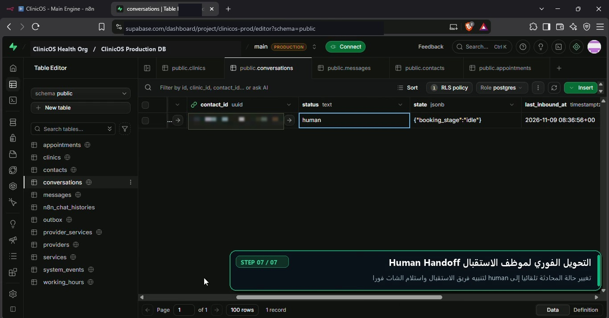

<div align="center">


<br />

# 🏥 ClinicOS `v3.3` — WhatsApp AI Receptionist & Appointment Engine
### منظومة الاستقبال الذكي وإدارة حجوزات العيادات عبر واتساب بالصوت والنص

[](https://youtu.be/YoO-eJfvpjM)
[](./workflow/clinicos-main-engine.l2v.json)
[](./prompts/receptionist-system-prompt.xml)
[](./prompts/voice-transcription-prompts.md)
[](./database/)
[](./workflow/clinicos-main-engine.l2v.json)
[-22c55e?style=for-the-badge&logo=checkmarx&logoColor=white)](./tests/test_270_messages.js)

<p align="center">
  
  
  
  
  
</p>

<p align="center">
  <a href="#-executive-overview--نبذة-عن-المشروع">🎯 Overview</a> •
  <a href="#-n8n-30-node-pipeline-architecture--معمارية-ورك-فلو-n8n">⚙️ n8n Pipeline</a> •
  <a href="#-senior-engineering-decisions--قرارات-التصميم-الهندسية">🧱 Engineering Decisions</a> •
  <a href="#lead-to-visit-add-on">🎯 Lead-to-Visit Add-on</a> •
  <a href="#-314-scenario-adversarial--qa-benchmark--اختبارات-الجودة-والاختراق-314314-passed">🛡️ 314-Test Benchmark</a> •
  <a href="#-visual-walkthrough--استعراض-النظام">🎥 Walkthrough</a> •
  <a href="#-quick-start--خطوات-التشغيل">🚀 Quick Start</a>
</p>

</div>

---

## 🎯 Executive Overview | نبذة عن المشروع

**ClinicOS (`v3.3`)** is a **WhatsApp AI Receptionist, Appointment Management & Lead-to-Visit Engine** built for specialty medical clinics (Dentistry, Dermatology & Laser).

To prevent an LLM from hallucinating available slots, losing context across turns, misinterpreting colloquial Arabic voice notes, or double-booking providers when two patients message concurrently, **ClinicOS enforces a strict architectural separation of concerns:**

> 🧠 **The AI Talks, The Database Decides.**
> OpenAI `gpt-4.1` and `gpt-4o-transcribe` handle natural conversation, dialect adaptation (`ar-EG`, `ar-SA`, `en`), and compound-intent understanding — while a **4-layer deterministic JavaScript guardrail engine in `n8n`** and **atomic `Supabase PostgreSQL` RPCs** control slot availability, first-time patient registration, GiST exclusion locking, idempotent outbox dispatch, medical safety escalation, and Lead-to-Visit (`l2v`) qualification and SLA routing.

نظام **ClinicOS** هو محرك استقبال ذكي وإدارة حجوزات للعيادات الطبية عبر واتساب، يجمع بين **المحادثة الطبيعية** في فهم الرسائل النصية والصوتية باللهجة المصرية والسعودية والإنجليزية، وبين **الحتمية الصارمة على مستوى قاعدة البيانات** لمنع هلوسة المواعيد أو الأسعار أو تضارب الحجوزات.

---

## 🏗️ System Architecture | المعمارية الهندسية الشاملة

```mermaid
flowchart TB
    subgraph S1["1️⃣ Webhook Security & HMAC Ingestion"]
        WA["📱 Meta WhatsApp Cloud API v21.0"] -->|GET Challenge| GET_WH["GET Webhook"]
        GET_WH --> VERIFY_TOK["Verify Token (Vault RPC)"] --> CHAL_REPLY["Challenge Reply"]
        WA -->|POST Event + X-Hub-Signature-256| POST_WH["WhatsApp Webhook"]
        POST_WH --> RAW_BODY["Extract Raw Body (SHA-256 Prep)"]
        RAW_BODY --> INGEST["Verify & Save Event\npublic.ingest_meta_webhook_batch()"]
    end

    subgraph S2["2️⃣ State-Aware Voice Note Pipeline"]
        INGEST --> IS_VOICE{"Is Voice Note?"}
        IS_VOICE -->|audio / voice| GET_URL["Get Audio URL (Graph API)"]
        GET_URL --> DL_VOICE["Download OGG Stream"]
        DL_VOICE --> STT["Transcribe Voice (gpt-4o-transcribe)\n+ Dynamic Pending-Slot Vocabulary"]
        STT --> SAVE_STT["Save & Inject Transcript\npublic.apply_voice_transcription()"]
    end

    subgraph S3["3️⃣ Turn Router & Persistent Memory Loader"]
        IS_VOICE -->|text / media| PARSE_TURN["Parse Turn & State\nPrune Expired Holds + Media Fallbacks"]
        SAVE_STT --> PARSE_TURN
        PARSE_TURN --> ROUTE{"Route Turn"}
        ROUTE -->|AI Assistant| LOAD_CTX["Load Clinic Context\nSnapshot + 16-Turn History + Patient Profile"]
    end

    subgraph S4["4️⃣ Hybrid AI Agent & 4-Layer Deterministic Guardrails"]
        LOAD_CTX --> AI_AGENT["AI Receptionist (OpenAI GPT-4.1)\nStructured JSON Contract"]
        AI_AGENT --> PARSE_AI["Parse AI Output\n4-Layer Slot Resolver + Name/Phone Gate"]
        PARSE_AI --> EMERG_GUARD["Emergency & Medical Safety Guard\nHard Regex + LLM Escalation"]
    end

    subgraph S5["5️⃣ Atomic Slot Engine & Transactional Commit"]
        EMERG_GUARD --> SEARCH_IF{"Search Slots?"}
        SEARCH_IF -->|true| GET_SLOTS["Get Slots\nPrimary Window + 7-Day Fallback CTE"]
        GET_SLOTS --> FMT_SLOTS["Format Slot List\nAuto-Preselect Exact Match"]
        FMT_SLOTS --> SAVE_STATE["Save State & Enqueue\nbook / reschedule / cancel / profile / outbox"]
        SEARCH_IF -->|false| SAVE_STATE
        ROUTE -->|Direct Reply| SAVE_STATE
    end

    subgraph S6["6️⃣ Durable Outbox & 24h Reminder Dispatcher"]
        TIMER["⏰ Reminder & Outbox Timer (Every 15m)"] --> CLAIM["Claim Outbox\nFOR UPDATE SKIP LOCKED + Lease Token"]
        SAVE_STATE --> CLAIM
        CLAIM --> BUILD_WA["Build WhatsApp Payload"]
        BUILD_WA --> SEND_WA["Send WhatsApp Message"]
        SEND_WA --> PARSE_SEND["Parse Send Result\nClassify Retryable vs Permanent"]
        PARSE_SEND --> REC_SEND["Record Send Result\nExponential Backoff / Dead-Letter Alert"]
    end
```



---

## ⚙️ n8n 30-Node Pipeline Architecture | تشريح عقد ورك فلو n8n بالتفصيل

The workflow ([`workflow/clinicos-main-engine.json`](./workflow/clinicos-main-engine.json)) is architected into **6 decoupled operational stages** across **30 specialized nodes**:

### Stage 1: Cryptographic Webhook Verification & Idempotent Ingestion (5 Nodes)
| Node Name | Type | Engineering Responsibility |
| :--- | :--- | :--- |
| **`GET Webhook`** | `Webhook` | Receives Meta verification handshakes (`hub.mode`, `hub.verify_token`, `hub.challenge`). |
| **`Verify Token`** | `Postgres` | Calls `public.verify_meta_webhook_challenge()` against encrypted Supabase Vault secrets. |
| **`Challenge Reply`** | `Respond to Webhook` | Returns HTTP `200` plain-text challenge on match or HTTP `403` on mismatch. |
| **`WhatsApp Webhook`** | `Webhook` | Captures raw binary POST payloads from Meta Cloud API to preserve exact byte order for HMAC verification. |
| **`Extract Raw Body`** | `Code (JS)` | Extracts raw UTF-8 string + `x-hub-signature-256` header before JSON parsing can mutate whitespace. |
| **`Verify & Save Event`** | `Postgres` | Executes `public.ingest_meta_webhook_batch()`: verifies `HMAC-SHA256`, deduplicates by `provider_message_id`, handles `STOP`/`START` opt-outs, and locks the conversation row (`FOR UPDATE`). |

### Stage 2: Context-Aware Voice Note Transcription Pipeline (5 Nodes)
| Node Name | Type | Engineering Responsibility |
| :--- | :--- | :--- |
| **`Is Voice Note?`** | `If` | Routes inbound `audio` / `voice` messages to the transcription pipeline while passing text straight through. |
| **`Get Audio URL`** | `HTTP Request` | Queries Meta Graph API `v21.0` to resolve the temporary media download URL for the voice note ID. |
| **`Download Voice`** | `HTTP Request` | Streams the binary `.ogg` Opus audio file from Meta's CDN into n8n binary memory. |
| **`Transcribe Voice`** | `HTTP Request` | Sends audio to OpenAI `gpt-4o-transcribe` with a **state-aware prompt** that injects currently offered slot times & doctor names when `pending_booking` is active. |
| **`Save & Inject Transcript`** | `Postgres` | Persists the transcript into `public.messages` via `public.apply_voice_transcription()` and injects it into the turn payload. |

### Stage 3: Turn Router & Persistent Memory Loader (3 Nodes)
| Node Name | Type | Engineering Responsibility |
| :--- | :--- | :--- |
| **`Parse Turn & State`** | `Code (JS)` | Filters out muted/human-mode threads, prunes expired `pending_booking` holds (`> 20 min`), and generates instant localized fallbacks for unsupported attachments (locations, images, empty audio). |
| **`Route Turn`** | `Switch` | Routes actionable turns to the `AI Assistant` branch or short-circuits media fallbacks directly to `Save State & Enqueue`. |
| **`Load Clinic Context`** | `Postgres` | Single round-trip query fetching: (1) `get_clinic_snapshot`, (2) `get_conversation_fresh_state`, (3) `get_upcoming_appointments`, (4) last 16 messages (`get_conversation_context`), and (5) **`get_patient_profile`** (long-term patient memory). |

### Stage 4: Hybrid AI Receptionist & 4-Layer Deterministic Guardrails (4 Nodes)
| Node Name | Type | Engineering Responsibility |
| :--- | :--- | :--- |
| **`AI Receptionist`** | `LangChain Agent` | Runs with `maxIterations: 4` and a structured XML system prompt ([`prompts/receptionist-system-prompt.xml`](./prompts/receptionist-system-prompt.xml)), receiving sanitized `<patient_message>` tags and `patient_memory`. |
| **`OpenAI Chat Model`** | `OpenAI LM` | Configured with `gpt-4.1` (`temperature: 0.2`) for Arabic/English dialect generation and structured JSON output. |
| **`Parse AI Output`** | `Code (JS)` | **The Core Deterministic Engine:** 550+ lines of defensive JS enforcing 4-layer slot resolution, negation guards, service-code catalog mapping, nickname sanitization, and the **First-Time Patient Name & Phone Registration Gate**. |
| **`Emergency Reply Guard`** | `Code (JS)` | Guarantees that any medical emergency immediately receives emergency instructions (using `clinic_snapshot.emergency_number` when configured) and transitions `target_status = 'human'`. |

### Stage 5: Atomic Slot Search & Transactional State Commit (4 Nodes)
| Node Name | Type | Engineering Responsibility |
| :--- | :--- | :--- |
| **`Search Slots?`** | `If` | Branches to `Get Slots` only when `should_query_slots === true` and `needs_human === false`. |
| **`Get Slots`** | `Postgres` | Runs a 2-stage CTE calling `public.get_available_slots()`: searches the patient's requested window first (`exact_match = true`), and automatically falls back to the nearest 5 slots in the next 7 days (`exact_match = false`) if the requested window is full or falls on a weekend (Friday/Saturday). |
| **`Format Slot List`** | `Code (JS)` | Formats slots in natural Arabic/English, auto-preselects `selected_slot` when the patient requested a specific hour that is available, and builds the 20-minute `pending_booking` hold. |
| **`Save State & Enqueue`** | `Postgres` | **Single Atomic Commit:** checks `get_conversation_fresh_state()` to abort superseded turns, updates `patient_profile`, executes `book_appointment` / `reschedule_appointment` / `cancel_appointment`, updates `conversations.state`, and enqueues the outbound WhatsApp reply. |

### Stage 6: Durable Transactional Outbox, 24h Reminders & Error Telemetry (8 Nodes)
| Node Name | Type | Engineering Responsibility |
| :--- | :--- | :--- |
| **`Reminder & Outbox Timer`** | `Schedule Trigger` | Fires every 15 minutes to sweep pending outbox messages and enqueue 24-hour appointment reminders. |
| **`Claim Outbox`** | `Postgres` | Claims a batch of 10 due messages via `private.claim_outbox_batch_with_route()` (`FOR UPDATE SKIP LOCKED`) and validates lease tokens via `public.authorize_outbox_send()`. |
| **`Build WhatsApp Payload`** | `Code (JS)` | Transforms outbox rows into Meta Graph API `v21.0` payloads (`text`, `template`, or `interactive`). |
| **`Send WhatsApp Message`** | `HTTP Request` | Dispatches messages with `neverError: true` and `fullResponse: true` so HTTP `4xx`/`5xx` responses are captured for structured retry classification. |
| **`Parse Send Result`** | `Code (JS)` | Inspects Meta error codes (`130429` rate limit, `190` auth, `4xx` permanent vs `5xx` transient) to classify failures as `retryable`, `permanent`, or `unknown`. |
| **`Record Send Result`** | `Postgres` | Calls `mark_outbox_sent()` or `mark_outbox_failure()` (exponential backoff up to 5 attempts, then dead-letter alerting to `system_events`). |
| **`Error Trigger` + `Log Workflow Error`** | `Error Trigger` / `Postgres` | Captures any unexpected runtime exception across the workflow and logs structured diagnostics to `public.log_workflow_error()`. |

---

## 🧱 Senior Engineering Decisions | قرارات التصميم الهندسية المتقدمة

| Engineering Challenge | Naive Chatbot Approach ❌ | ClinicOS `v3.3` Production Solution ✅ |
| :--- | :--- | :--- |
| **1. Memory Across Sessions & Restarts** | Uses n8n `Window Buffer Memory` (wipes on restart, crashes on concurrent webhooks, forgets cancelled bookings). | **Database-Backed Patient Memory (`public.get_patient_profile` + `update_patient_profile`)**: stores `preferred_name`, `registered_name`, `booking_phone`, `preferred_dialect`, `last_service_code`, and `last_cancelled_appointment` persistently in PostgreSQL. |
| **2. First-Time Patient Registration** | Either books anonymously under a WhatsApp nickname or forces a rigid 5-step form on every visit. | **Smart Name & Phone Gate (Option 1)**: On a new patient's first booking, holds the chosen slot (`awaiting_contact_info = true`) and asks warmly for **Full Name + Phone** (or *"على نفس الرقم ده"*). Once provided, confirms immediately in DB and **remembers them automatically on all future bookings**. |
| **3. LLM Slot & Service Hallucination** | Trusts LLM text output ("I booked you for 10 AM") or lets the LLM invent service codes (`BOTOX_SESSION`). | **4-Layer Deterministic Resolver + Catalog Alias Guard**: `resolveCatalogServiceCode()` maps AI outputs strictly onto live `clinic_snapshot.services[].code` (`DERM_CONSULT`, `TEETH_WHITENING`, `LASER_SESSION`, etc.), and `book_appointment` generates the confirmation message directly from PostgreSQL. |
| **4. Negation & Hesitation Traps** | Patient says *"لا تأكد الحجز دلوقتي"* or *"متأكدش"* — substring match on `"أكد"` falsely confirms the booking! | **Negation & Question Guard (`negationOrQuestionGuardRe`)**: Detects Arabic/English negations (`لا تأكد`, `متأكدش`, `مش عايز`, `استنى`, `don't confirm`, `wait`) before confirm verbs, unselects the slot safely, and asks how the patient wants to proceed. |
| **5. Side Questions Mid-Booking** | Patient asks *"هي العيادة فين؟"* or *"الدفع كاش ولا فيزا؟"* while choosing a slot — bot answers FAQ and wipes `pending_booking`. | **Stateful Context Preservation**: Preserves `pending_booking` in `conversations.state` during side FAQs and appends a natural contextual reminder to complete the pending slot selection or contact registration. |
| **6. Race Conditions & Double-Booking** | Two patients pick 10:00 AM simultaneously, or one patient sends 3 rapid messages. | **`FOR UPDATE` Row Locking + GiST Exclusion Constraint**: `appointments_no_overlap` guarantees zero overlapping appointments at the PostgreSQL index level; superseded turns abort cleanly before writing state. |

---

## Lead-to-Visit add-on

The **Lead-to-Visit (`l2v`) add-on** extends ClinicOS so that inbound leads—especially from Click-to-WhatsApp ads—are captured, qualified, assigned to reception staff during clinic working hours with a WhatsApp quick-reply button, escalated automatically if unacknowledged within the SLA window, and reported via daily ad vs. organic funnel metrics and a header-authenticated Dashboard API.

### What it does
- **Guarded Lead Attribution (`L2V Prepare` -> `L2V Gate` -> `l2v.capture_lead_guarded` -> `l2v.capture_lead`):** Captures an open lead in `l2v.leads` when an inbound message includes a Meta Click-to-WhatsApp referral (`payload.referral`, setting `source = 'click_to_whatsapp'` and `campaign = referral.headline ?? referral.source_id`) or when the contact has no `confirmed` or `completed` appointment in `public.appointments` (`source = 'organic'`). If an organic lead later clicks a paid ad, `l2v.capture_lead` upgrades `source` from `'organic'` to the paid source; if a converted patient returns via a new ad referral, `l2v.capture_lead_guarded` closes the old lead and opens a fresh funnel lead (and `l2v.close_lead` allows explicit manual closure).
- **Staff Message Isolation (`l2v.is_staff` + `l2v.rep_ack` + `Is Staff?`):** Recognizes active receptionists (`l2v.reps.is_active = true`) and the clinic manager (`l2v.settings.manager_contact_id`) by phone (`public.contacts.phone_e164`). When an active receptionist taps the WhatsApp quick-reply button (`استلمت العميل`), `L2V Gate` marks their oldest `pending` assignment in `l2v.assignments` as `acked` (`l2v.rep_ack`) and `Is Staff?` stops the turn so **the AI receptionist never replies to staff**.
- **Deterministic Lead Qualification (`Parse AI Output` -> `L2V Qualify?` -> `L2V Qualify`):** Extracts structured signals (`lead_timing`: `now | this_month | later`, `lead_budget_band`: `high | mid | low`), suppresses them to `null` on medical, emergency, complaint/human-handoff, or prompt-injection turns, preserves explicit catalog `service_name_ar` on pricing/service FAQs, and scores the open lead (`score` in `l2v.leads`, `hot` >= 70, `warm` 30..69, `cold` < 30; `l2v.leads.status` values are strictly `new`, `hot`, `warm`, `cold`, `closed`) via `l2v.qualify_contact` -> `l2v.set_qualification`.
- **Working Hours & Overnight Release (`l2v.settings` + `l2v.is_clinic_open` + `l2v.release_overnight`):** `l2v.settings` supports optional `open_time` (`time`), `close_time` (`time`), and `open_days` (`smallint[]`, `0 = Sunday .. 6 = Saturday`), evaluated in the clinic's `public.clinics.timezone`. Default `NULL` means always open (immediate handoff). When the clinic is closed, a newly qualified `hot` lead stays `hot` and unassigned (`assignment_id = null`), and `l2v.escalate_overdue` suppresses SLA escalations and manager alerts. Once the clinic opens, `l2v.release_overnight()` assigns all unassigned `hot` leads in round-robin order with `sla_due_at` starting at opening time.
- **Round-Robin Handoff & 15-Minute SLA Escalation (`ClinicOS L2V SLA Tick` -> `Escalate Overdue Leads`):** Runs `SELECT l2v.release_overnight() AS released, l2v.escalate_overdue() AS escalated;` every minute. Active reps (`l2v.reps.is_active`) receive `lead_handoff` via `l2v._notify` -> `public.enqueue_message` with a quick-reply button (`payload = 'l2v_ack:' || assignment_id`). If the patient books a `confirmed` or `completed` appointment after the lead was created, `l2v.escalate_overdue` transitions `l2v.assignments.status` (`pending | acked | escalated | closed_booked`) from `pending` to `closed_booked` without escalation; otherwise, while the clinic is open, overdue `pending` rows (`sla_due_at <= now()`) become `escalated`, move to the next eligible active rep, and notify `manager_contact_id` via `sla_breach` (or `sla_breach_no_rep` when all active reps have been tried).
- **Fail-Open Inbound Reliability:** `L2V Gate` and `L2V Qualify` set `onError: "continueRegularOutput"`, and `L2V Merge` defaults `l2v_is_staff = false` (using `$('Parse Turn & State').all()[$itemIndex]` fallback if item pairing is lost), ensuring an add-on error never stops a patient from getting a reply.
- **Daily Funnel Reporting & Dashboard API (`l2v.kpi_daily` + `l2v.recent_leads` + `ClinicOS Dashboard API`):**
  - `l2v.kpi_daily(p_clinic_id uuid, p_from date, p_to date)` returns `(day, leads, hot_leads, avg_first_reply_s, escalations, booked_leads, visits, no_shows, leads_ads, leads_organic)` where `leads_ads + leads_organic = leads` (`avg_first_reply_s` measures the bot's automated WhatsApp reply via `public.outbox` / `public.messages`, not human staff speed).
  - [`workflow/clinicos-dashboard-api.json`](./workflow/clinicos-dashboard-api.json) (`ClinicOS Dashboard API`, **9 nodes**) exposes a `GET` endpoint (`/webhook/clinicos/dashboard?from=YYYY-MM-DD&to=YYYY-MM-DD`) protected by n8n `headerAuth` (`YOUR_DASHBOARD_HEADER_AUTH_CREDENTIAL_ID`), fails closed (`HTTP 400`) on invalid or `> 90`-day date ranges, and returns `l2v.kpi_daily` plus the latest 50 leads from `l2v.recent_leads` with `phone_masked` masking all digits except the last 3 (`+*********NNN`).
  - [`dashboard/index.html`](./dashboard/index.html) reads `DASHBOARD_CONFIG` (`apiUrl`, `apiToken`, `headerName: 'x-dashboard-token'`) at the top of its script, renders strictly via `textContent` and `escapeHtml()`, and displays a prominent **`DEMO DATA`** banner (`demoDataBanner`) whenever the API is unconfigured or unreachable.

### Install order & Multi-Clinic Bootstrap (Option 1: One Supabase Project per Clinic)
1. **Generate clinic seed & install commands with [`scripts/new_clinic.sh`](./scripts/new_clinic.sh):**
   ```bash
   ./scripts/new_clinic.sh \
     --name "Clinic Name" \
     --phone-number-id "<META_PHONE_NUMBER_ID>" \
     --timezone "Africa/Cairo" \
     --utc-offset "+02:00" \
     --out ./clinic_seed.sql
   ```
   `scripts/new_clinic.sh` generates a fresh `CLINIC_ID` UUID, writes an idempotent clinic seed SQL (`public.clinics` with `timezone`, `settings.utc_offset`, `settings.snapshot`, placeholder `public.providers` / `public.services` / `public.working_hours`, and `whatsapp_templates` keys), prints the ordered `psql` install commands, and prints the three Arabic Meta template texts from [`docs/l2v/TEMPLATES.md`](./docs/l2v/TEMPLATES.md).
2. **Run the PostgreSQL scripts in exact order (`ON_ERROR_STOP=1`):**
   1. [`database/01_schema.sql`](./database/01_schema.sql) — `private` schema, core `public.*` tables, GiST exclusion constraint `appointments_no_overlap`, and indexes.
   2. [`database/02_booking_and_outbox_rpcs.sql`](./database/02_booking_and_outbox_rpcs.sql) — core booking, reschedule, cancellation, outbox, webhook HMAC/Vault, and single-clinic `public.log_workflow_error` RPCs.
   3. [`database/02a_live_sync_profile_and_slots.sql`](./database/02a_live_sync_profile_and_slots.sql) — `contacts.patient_profile` column, `public.get_patient_profile`, `public.update_patient_profile`, and 7-parameter `public.get_available_slots(..., p_ignore_appointment_id)`.
   4. [`database/03_rls_policies.sql`](./database/03_rls_policies.sql) — requires `psql -v ON_ERROR_STOP=1 -v clinic_id=<CLINIC_ID> -f database/03_rls_policies.sql` (fails closed if `clinic_id` is omitted or invalid) and scopes all 12 `clinicos_api_owner` RLS policies to `<CLINIC_ID>`. For **Supabase SQL Editor** users (without `psql`), use [`database/03a_rls_policies_template.sql`](./database/03a_rls_policies_template.sql) and replace `<CLINIC_UUID>` with `<CLINIC_ID>` (fails closed with `RAISE EXCEPTION` if `<CLINIC_UUID>` is not replaced).
   5. Your generated `./clinic_seed.sql` from `scripts/new_clinic.sh` (or [`database/04_seed_data.sql`](./database/04_seed_data.sql) for local demo installs only, using fake demo UUID `00000000-0000-4000-8000-000000000001`).
   6. [`database/05_lead_engine.sql`](./database/05_lead_engine.sql) — schema `l2v`, tables (`l2v.settings`, `l2v.reps`, `l2v.leads`, `l2v.assignments`), and `SECURITY DEFINER` RPCs (`l2v._notify`, `l2v.is_staff`, `l2v.is_clinic_open`, `l2v.capture_lead`, `l2v.capture_lead_guarded`, `l2v.assign_lead`, `l2v.set_qualification`, `l2v.qualify_contact`, `l2v.rep_ack`, `l2v.close_lead`, `l2v.release_overnight`, `l2v.escalate_overdue`, `l2v.kpi_daily`, `l2v.recent_leads`).
   7. *(Optional — demo/staging setup only)* [`database/05b_l2v_seed_example.sql`](./database/05b_l2v_seed_example.sql) — seeds placeholder `+201000000001`..`+201000000003` contacts, `sla_minutes = 15`, two example reps, and `whatsapp_templates` keys. **Never run on a clinic that already has real staff configured.**
3. **Import n8n workflows & configure settings:**
   - Import [`workflow/clinicos-main-engine.l2v.json`](./workflow/clinicos-main-engine.l2v.json) (`ClinicOS - Main Engine`, **36 nodes**, 1-minute `Reminder & Outbox Timer`), [`workflow/clinicos-l2v-sla-tick.json`](./workflow/clinicos-l2v-sla-tick.json) (`ClinicOS L2V SLA Tick`, **4 nodes**), and [`workflow/clinicos-dashboard-api.json`](./workflow/clinicos-dashboard-api.json) (`ClinicOS Dashboard API`, **9 nodes**).
   - Bind real n8n credentials in place of placeholders (`YOUR_POSTGRES_CREDENTIAL_ID`, `YOUR_WHATSAPP_CREDENTIAL_ID`, `YOUR_OPENAI_CREDENTIAL_ID`, `YOUR_DASHBOARD_HEADER_AUTH_CREDENTIAL_ID`).
   - In **Workflow Settings** for each workflow, set **Error Workflow** to **the workflow itself** (`Error Trigger` -> `Log Workflow Error`).
   - **Manually activate `ClinicOS L2V SLA Tick`** (and `ClinicOS Dashboard API` / `ClinicOS - Main Engine`) in n8n, as imported workflows start inactive by default.
4. **Submit Meta WhatsApp templates per clinic:**
   - In each clinic's Meta WhatsApp Business Account, submit the three Arabic `UTILITY` templates (`lead_handoff` with quick-reply button `استلمت العميل`, `sla_breach`, and `sla_breach_no_rep`) with the exact body text and variable order in [`docs/l2v/TEMPLATES.md`](./docs/l2v/TEMPLATES.md), and ensure their approved names match `public.clinics.settings -> 'whatsapp_templates'`.
5. **Staging verification runbook:** Follow **[`docs/l2v/STAGING.md`](./docs/l2v/STAGING.md)** for the full human staging runbook (staging Supabase + n8n + Meta test number setup, activation order, 8-step acceptance + voice/batch tests, and failure triage).

### Acceptance checklist for the whole add-on (manual, in staging, by a human)
1. Ad message -> a row in `l2v.leads` with `source` and `campaign` (`leads_ads` increments).
2. Patient says "I want to start this week" and the price is fine -> lead becomes `hot` and (during open hours) the rep gets the `lead_handoff` template with the `استلمت العميل` button (during closed hours it stays `hot` and unassigned until `l2v.release_overnight()` runs at opening time).
3. Rep taps the button -> assignment in `l2v.assignments` becomes `acked`, the AI does **not** answer the rep.
4. Nobody taps for 15 minutes (during open hours) -> the assignment becomes `escalated`, the next active rep gets it, and the manager gets `sla_breach`.
5. Patient books before the SLA ends -> `l2v.assignments.status` becomes `closed_booked`, no escalation.
6. `l2v.kpi_daily` and `ClinicOS Dashboard API` return matching numbers (`day`, `leads`, `hot_leads`, `avg_first_reply_s`, `escalations`, `booked_leads`, `visits`, `no_shows`, `leads_ads`, `leads_organic` with `leads_ads + leads_organic = leads`) and masked recent leads (`phone_masked`).

---

## 🛡️ 314-Scenario Adversarial & QA Benchmark | اختبارات الجودة والاختراق (`314/314 Passed`)

ClinicOS includes a zero-dependency automated evaluation and Red-Team regression suite in **[`tests/test_270_messages.js`](./tests/test_270_messages.js)** (`314/314` passing), a workflow structure, L2V contract, SLA Tick, and Dashboard API mutation validator in **[`tests/validate_workflow.js`](./tests/validate_workflow.js)**, an L2V PostgreSQL test suite in **[`tests/l2v/l2v_addon_test.sql`](./tests/l2v/l2v_addon_test.sql)** (`./tests/l2v/run_local.sh`), and an empty-database clean-install + `pg_proc` signature drift harness in **[`tests/clean_install_test.sh`](./tests/clean_install_test.sh)**:

```bash
node tests/test_270_messages.js
node tests/validate_workflow.js workflow/clinicos-main-engine.json workflow/clinicos-main-engine.l2v.json
./tests/l2v/run_local.sh
./tests/clean_install_test.sh
```

| Category | Scenarios | Result | What It Verifies |
| :--- | :---: | :---: | :--- |
| **1. Live Conversation Replay** | `12` | ✅ `12/12` | Replays multi-turn WhatsApp conversations including voice notes, mid-flow FAQs, cancellation, and post-cancel memory recall (`"خليه الساعة 4 بدل 10"`). |
| **2. Egyptian Arabic (`ar-EG`) Slot & Confirm** | `40` | ✅ `40/40` | 1-step & 2-step confirmations, clock times (`10 ونص`, `١١ بالظبط`), ordinals (`الأول`, `التاني`, `الأخير`), typos (`تكد`, `ايوااا`), and negation guards (`متأكدش`). |
| **3. Egyptian Arabic (`ar-EG`) Booking Inference** | `10` | ✅ `10/10` | Implicit symptom-to-service routing (`ضرسي واجعني`, `عايز أشيل الجير`, `تصبغات في وشي`) and doctor-to-specialty matching. |
| **4. Reschedule & Cancellation Flows** | `10` | ✅ `10/10` | Single vs. multi-appointment disambiguation, cancelling temporary holds vs. confirmed bookings, and empty-appointment guards. |
| **5. Saudi / Gulf Dialect (`ar-SA`)** | `40` | ✅ `40/40` | Gulf phrasing (`أبغى`, `وش المواعيد`, `بكم`, `طال عمرك`, `اعتمدوه`, `لا هنت`) without mixing Egyptian words. |
| **6. English (`en`) End-to-End Flows** | `30` | ✅ `30/30` | Full English booking, slot selection, rescheduling, cancellation, FAQs, and medical/emergency handoffs. |
| **7. Messy / Multi-Intent / State Edge Cases** | `40` | ✅ `40/40` | Compound FAQ + booking in one message, switching service or doctor mid-flow, expired `pending_booking` pruning, and unsupported media fallbacks. |
| **8. Adversarial & Medical Safety** | `18` | ✅ `18/18` | Severe bleeding/swelling/breathing emergencies, antibiotic prescription refusals, prompt injection (`ignore previous instructions`), and SQL/XSS payloads. |
| **9. Red-Team & Vulnerability Regression** | `51` | ✅ `51/51` | Fake confirmation hallucination blocking, stopword name-extraction guards (`"أنا اسمي عايز احجز"`), nickname sanitization (`يا زيزو` → `يا أستاذ زياد`), and cross-specialty mismatches. |
| **10. Option 1: Name & Phone Registration** | `10` | ✅ `10/10` | Holding slot for new patients, extracting `Full Name + Phone` or `"على نفس الرقم ده"`, single-message registration, and skipping prompt for returning patients. |
| **11. Live Catalog Service Resolution** | `10` | ✅ `10/10` | Verifies exact mapping against live clinic catalog (`DERM_CONSULT`, `TEETH_WHITENING`, `LASER_SESSION`, `DENTAL_CLEANING`, `DENTAL_CHECKUP`, `HYDRAFACIAL`). |
| **12. Wording Policy** | `13` | ✅ `13/13` | Ensures patient-facing wording comes from the AI via `aiWording(...)` while facts (slots, doctors, phones) come deterministically from code. |
| **13. Lead-to-Visit** | `30` | ✅ `30/30` | Verifies `L2V Prepare`, `Parse AI Output` lead-signal safety suppression & FAQ `service_name_ar`, multi-item voice batch routing, multi-clinic UUID/RLS checks, `ClinicOS Dashboard API` validation & phone masking, and SLA Tick / Dashboard mutation suites. |
| **TOTAL** | **`314`** | 🏆 **`314/314`** | **100% Pass Rate (`0 Failed`)** |

---

## 🎥 Visual Walkthrough | استعراض النظام بالصور والفيديو

<div align="center">

### ▶️ [شاهد الفيديو الكامل لاختبار النظام الحي (9 مراحل متتالية على واتساب وقاعدة البيانات) — Watch Full Live Demo on YouTube](https://youtu.be/YoO-eJfvpjM)

[-YouTube_HD-FF0000?style=for-the-badge&logo=youtube&logoColor=white)](https://youtu.be/YoO-eJfvpjM)

<a href="https://youtu.be/YoO-eJfvpjM" target="_blank">
  
</a>

</div>

<br />

| 1️⃣ Voice Note & Live Slot Search | 2️⃣ Instant Database Confirmation | 3️⃣ Smart Human Handoff (`status = human`) |
| :---: | :---: | :---: |
|  |  |  |
| Understands Arabic voice notes & queries live provider slots | Commits confirmed bookings atomically with Patient Name & Phone | Switches conversation to `status = human` on medical/staff escalation |

---

## 📂 Repository Structure | هيكل الفولدرات المنظم

| Folder / File | Description | المحتوى الهندسي |
| :--- | :--- | :--- |
| 📁 **[`workflow/`](./workflow/)** | [`clinicos-main-engine.json`](./workflow/clinicos-main-engine.json)<br>[`clinicos-main-engine.l2v.json`](./workflow/clinicos-main-engine.l2v.json)<br>[`clinicos-l2v-sla-tick.json`](./workflow/clinicos-l2v-sla-tick.json)<br>[`clinicos-dashboard-api.json`](./workflow/clinicos-dashboard-api.json) | ووركفلو **n8n** الأساسي (30 عقدة)، نسخة **Lead-to-Visit** الكاملة (36 عقدة، مؤقت Outbox كل دقيقة)، ووركفلو **`ClinicOS L2V SLA Tick`** (4 عقد)، ووركفلو **`ClinicOS Dashboard API`** (9 عقد). |
| 📁 **[`database/`](./database/)** | [`01_schema.sql`](./database/01_schema.sql)<br>[`02_booking_and_outbox_rpcs.sql`](./database/02_booking_and_outbox_rpcs.sql)<br>[`02a_live_sync_profile_and_slots.sql`](./database/02a_live_sync_profile_and_slots.sql)<br>[`03_rls_policies.sql`](./database/03_rls_policies.sql)<br>[`03a_rls_policies_template.sql`](./database/03a_rls_policies_template.sql)<br>[`04_seed_data.sql`](./database/04_seed_data.sql)<br>[`05_lead_engine.sql`](./database/05_lead_engine.sql)<br>[`05b_l2v_seed_example.sql`](./database/05b_l2v_seed_example.sql) | جداول ودوال الحجز والـ Outbox، ملف `02a` لمزامنة دوال ملف المريض والمواعيد (7 معاملات)، سياسات RLS المعلمية (`-v clinic_id=...` أو قالب `03a` لـ Supabase SQL Editor)، محرك **Lead-to-Visit (`l2v`)**، وملف البيانات التجريبية `05b`. |
| 📁 **[`nodes/`](./nodes/)** | [`parse_turn_and_state.js`](./nodes/parse_turn_and_state.js)<br>[`l2v_prepare.js`](./nodes/l2v_prepare.js)<br>[`parse_ai_output.js`](./nodes/parse_ai_output.js)<br>[`format_slot_list.js`](./nodes/format_slot_list.js)<br>[`dashboard_validate_query.js`](./nodes/dashboard_validate_query.js)<br>[`dashboard_format_response.js`](./nodes/dashboard_format_response.js) | الكود المصدري (Source of Truth) لعقد JavaScript في n8n، متزامن ومفحوص آلياً مع ملفات الووركفلو. |
| 📁 **[`prompts/`](./prompts/)** | [`receptionist-system-prompt.xml`](./prompts/receptionist-system-prompt.xml)<br>[`voice-transcription-prompts.md`](./prompts/voice-transcription-prompts.md) | هندسة الأوامر (XML System Prompts) لموديل `GPT-4.1` وموديل الصوت `gpt-4o-transcribe`. |
| 📁 **[`scripts/`](./scripts/)** | [`build_l2v_workflow.js`](./scripts/build_l2v_workflow.js)<br>[`sync_node_code.js`](./scripts/sync_node_code.js)<br>[`new_clinic.sh`](./scripts/new_clinic.sh) | سكربتات بناء ومزامنة ملفات الووركفلو، وسكربت `new_clinic.sh` لتجهيز عيادة جديدة وقوالب واتساب الخاصة بها. |
| 📁 **[`docs/l2v/`](./docs/l2v/)** | [`TASKS.md`](./docs/l2v/TASKS.md)<br>[`TEMPLATES.md`](./docs/l2v/TEMPLATES.md)<br>[`STAGING.md`](./docs/l2v/STAGING.md) | خطة ومعمارية إضافة Lead-to-Visit، توثيق قوالب واتساب (`lead_handoff`, `sla_breach`, `sla_breach_no_rep`)، ودليل اختبار بيئة Staging خطوة بخطوة. |
| 📁 **[`tests/`](./tests/)** | [`test_270_messages.js`](./tests/test_270_messages.js)<br>[`validate_workflow.js`](./tests/validate_workflow.js)<br>[`clean_install_test.sh`](./tests/clean_install_test.sh)<br>[`clean_install_test.sql`](./tests/clean_install_test.sql)<br>[`l2v/l2v_addon_test.sql`](./tests/l2v/l2v_addon_test.sql)<br>[`l2v/run_local.sh`](./tests/l2v/run_local.sh) | حزمة الاختبارات الآلية الشاملة (**314 سيناريو** JS، فاحص عقد الووركفلو واختبارات الطفرات، اختبار التثبيت النظيف وفحص توافق `pg_proc`، واختبارات PostgreSQL لمحرك `l2v`). |
| 📁 **[`dashboard/`](./dashboard/)** | [`index.html`](./dashboard/index.html) | واجهة لوحة التحكم ومحاكي واتساب: تتصل بـ `ClinicOS Dashboard API` عند ضبط `DASHBOARD_CONFIG`، وتعرض لافتة **`DEMO DATA`** واضحة عند عدم الضبط أو تعذّر الاتصال. |
| 📁 **[`media/`](./media/)** | `hero-banner.png` + Walkthrough screenshots | الصور التوضيحية للنظام ومراحل الحجز والتحويل البشري. |
| 📄 **[`.env.example`](./.env.example)** | Environment variables template | نموذج متغيرات البيئة المطلوبة لتشغيل المشروع بأمان (بدون أي مفاتيح سرية). |

---

## 🚀 Quick Start | خطوات التشغيل السريع

### 1. Prepare Supabase Database
Generate your clinic seed SQL with **[`scripts/new_clinic.sh`](./scripts/new_clinic.sh)** and execute the SQL scripts in **[`database/`](./database/)** in order (`psql -v ON_ERROR_STOP=1`):
1. [`database/01_schema.sql`](./database/01_schema.sql) — `private` schema, core `public.*` tables, `appointments_no_overlap`, and indexes.
2. [`database/02_booking_and_outbox_rpcs.sql`](./database/02_booking_and_outbox_rpcs.sql) — Transactional booking, reschedule, cancellation, outbox, and single-clinic `public.log_workflow_error` RPCs.
3. [`database/02a_live_sync_profile_and_slots.sql`](./database/02a_live_sync_profile_and_slots.sql) — `patient_profile`, `public.get_patient_profile`, `public.update_patient_profile`, and 7-parameter `public.get_available_slots`.
4. [`database/03_rls_policies.sql`](./database/03_rls_policies.sql) — Run with `-v clinic_id=<CLINIC_ID>` to scope RLS policies and grants for `clinicos_api_owner` (or run [`database/03a_rls_policies_template.sql`](./database/03a_rls_policies_template.sql) in the Supabase SQL Editor after replacing `<CLINIC_UUID>` with `<CLINIC_ID>`).
5. Your generated clinic seed SQL from `./scripts/new_clinic.sh` (or [`database/04_seed_data.sql`](./database/04_seed_data.sql) for local demo data only).
6. [`database/05_lead_engine.sql`](./database/05_lead_engine.sql) — Lead-to-Visit (`l2v`) schema, tables (`l2v.settings`, `l2v.reps`, `l2v.leads`, `l2v.assignments`), working hours (`l2v.is_clinic_open`, `l2v.release_overnight`), SLA escalation (`l2v.escalate_overdue`), `l2v.kpi_daily`, and `l2v.recent_leads` RPCs.
7. *(Optional — demo/staging setup only)* [`database/05b_l2v_seed_example.sql`](./database/05b_l2v_seed_example.sql) — Example manager/rep staff contacts (`+20100000000x`), 15-minute SLA setting, and `whatsapp_templates` mapping. **Do not run on a clinic that already has real staff configured.**

### 2. Import the n8n Workflows
1. Open your **n8n** instance (`v1.80+` recommended) and import **[`workflow/clinicos-main-engine.l2v.json`](./workflow/clinicos-main-engine.l2v.json)** (36 nodes; or [`workflow/clinicos-main-engine.json`](./workflow/clinicos-main-engine.json) for the 30-node base engine without L2V), **[`workflow/clinicos-l2v-sla-tick.json`](./workflow/clinicos-l2v-sla-tick.json)** (`ClinicOS L2V SLA Tick`, 4 nodes), and **[`workflow/clinicos-dashboard-api.json`](./workflow/clinicos-dashboard-api.json)** (`ClinicOS Dashboard API`, 9 nodes).
2. Connect your credentials in n8n:
   - **PostgreSQL (`ClinicOS Runtime PostgreSQL`)**: Connect using `clinicos_n8n_runtime` (member of `clinicos_api_owner`) from `.env.example`.
   - **OpenAI (`OpenAI account`)**: API key with access to `gpt-4.1` and `gpt-4o-transcribe`.
   - **WhatsApp Cloud API (`WhatsApp account`)**: Meta Business System User access token.
   - **Header Auth (`ClinicOS Dashboard Header Auth`)**: Header `x-dashboard-token` for `ClinicOS Dashboard API`.
3. In n8n **Workflow Settings** for each workflow, set **Error Workflow** to **the workflow itself**, and **manually activate** `ClinicOS L2V SLA Tick` (plus `ClinicOS Dashboard API` and `ClinicOS - Main Engine`).

### 3. Run the 314-Scenario & Clean-Install Verification Suite
```bash
node tests/test_270_messages.js
node tests/validate_workflow.js workflow/clinicos-main-engine.json workflow/clinicos-main-engine.l2v.json
./tests/l2v/run_local.sh
./tests/clean_install_test.sh
```

### 4. Configure Meta Webhook & Templates
1. Submit the three Arabic `UTILITY` templates (`lead_handoff`, `sla_breach`, `sla_breach_no_rep`) per **[`docs/l2v/TEMPLATES.md`](./docs/l2v/TEMPLATES.md)**.
2. Set your WhatsApp Business App Webhook URL to:
```text
https://<YOUR_N8N_DOMAIN>/webhook/clinicos/meta
```
Subscribe to the `messages` webhook field, publish the workflows, and test against the 6-step acceptance checklist above.

---

## 👤 Author | المطور

**Ziad Mohamed** — AI Automation & Systems Engineer (`n8n` • `AI Agents` • `WhatsApp Cloud API` • `Supabase PostgreSQL`)
- 🔗 **LinkedIn:** [linkedin.com/in/ziad-mohamed-832807340](https://linkedin.com/in/ziad-mohamed-832807340)
- 📧 **Email:** [ziadautomation.ai@gmail.com](mailto:ziadautomation.ai@gmail.com)
- 💻 **GitHub:** [github.com/ziadmohamed-ai](https://github.com/ziadmohamed-ai)

---

<div align="center">
  <b>ClinicOS Engine v3.3</b>
</div>
